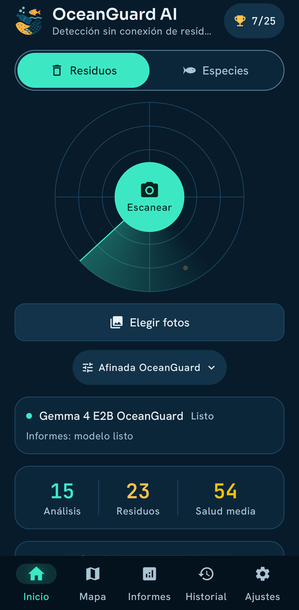
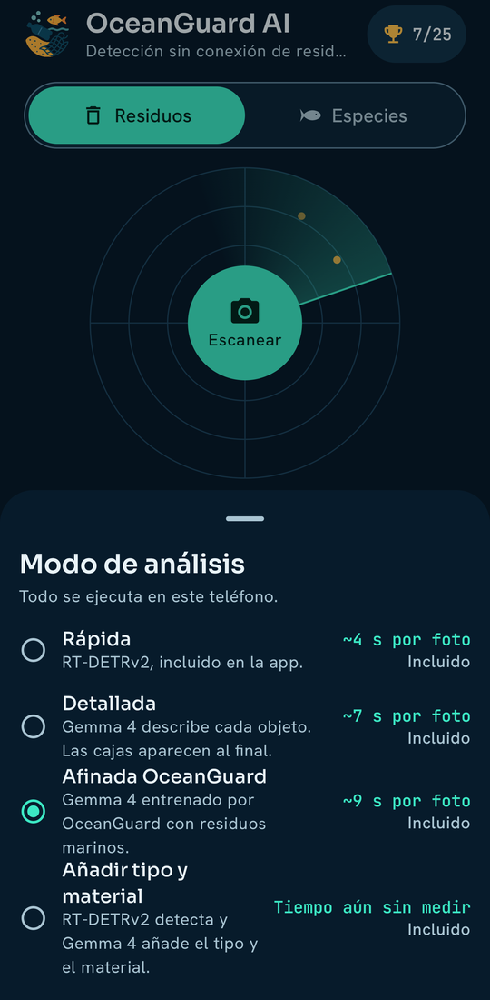
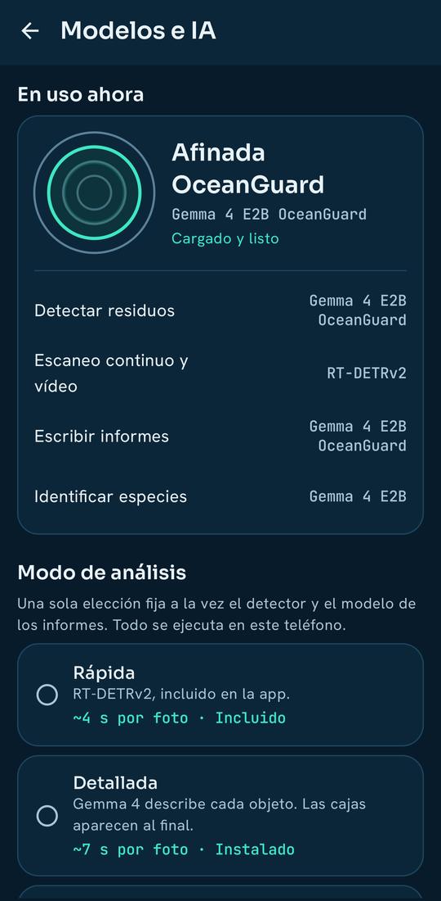
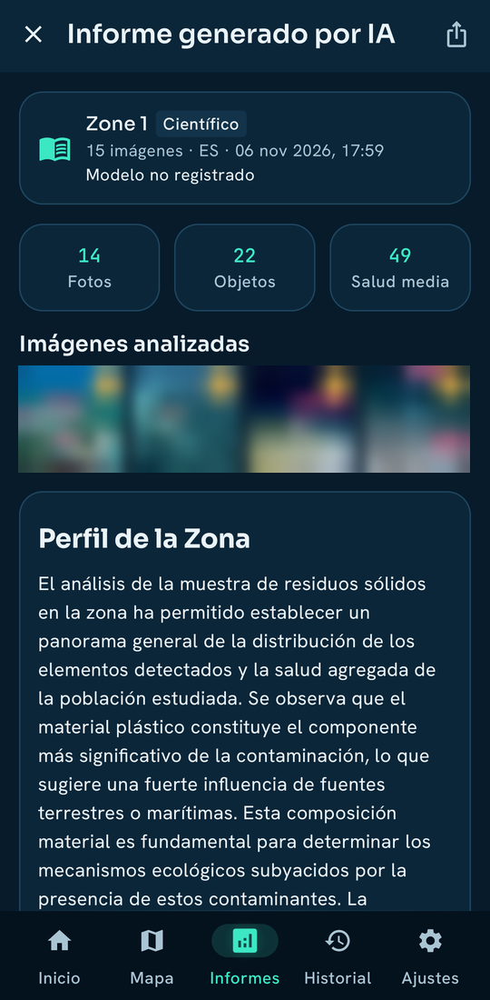
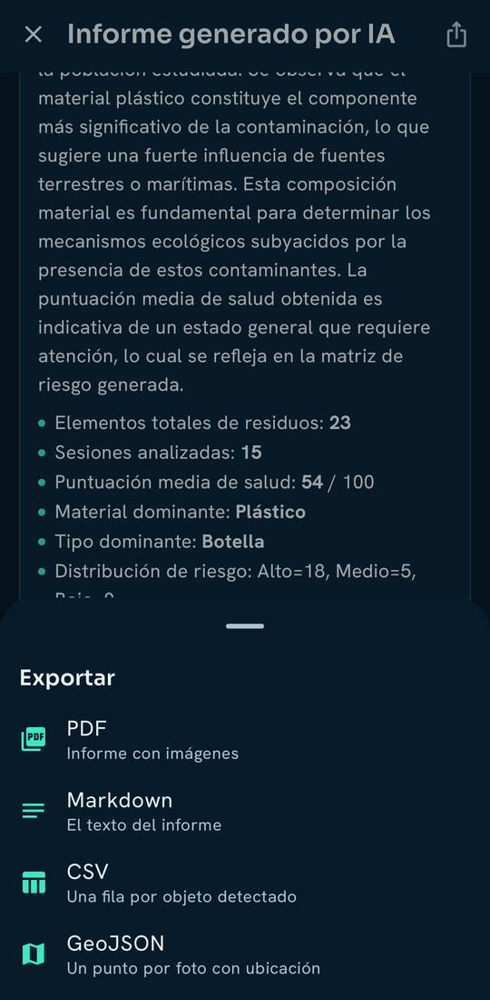
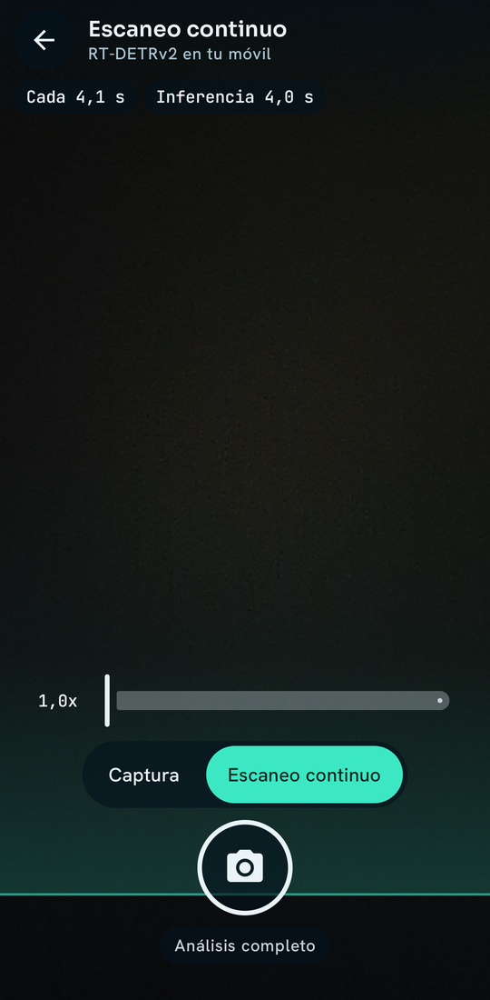
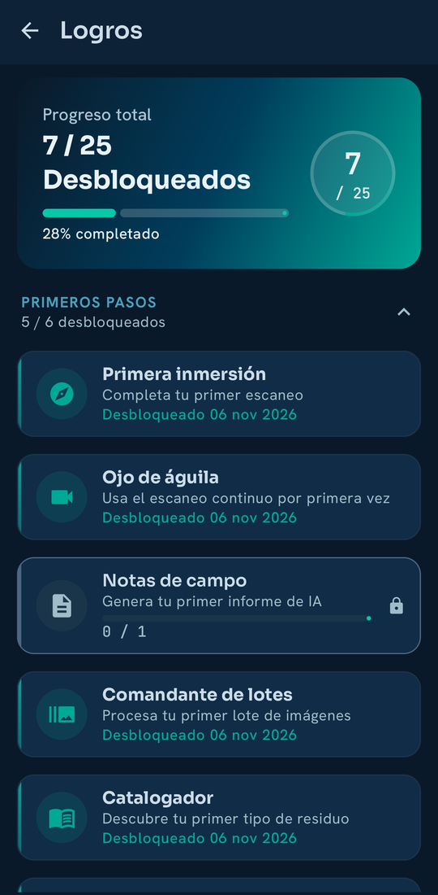
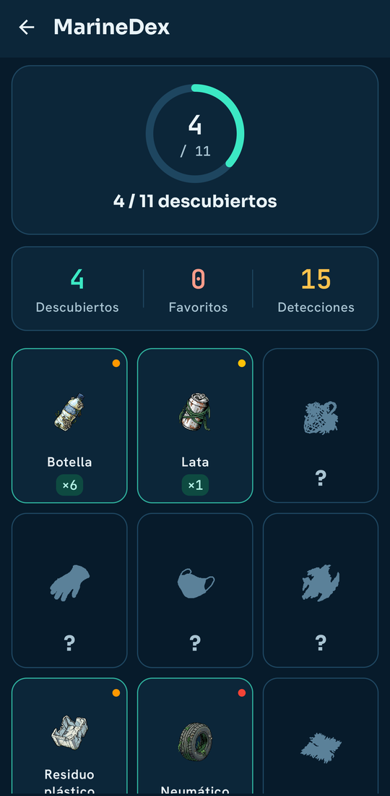
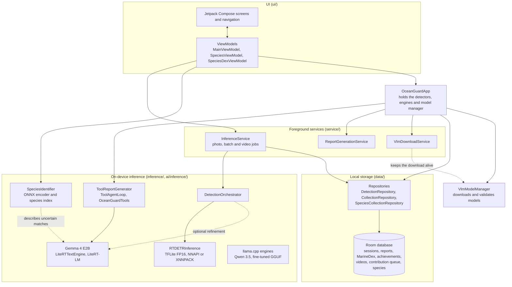

# OceanGuard AI - Android application

Android application that detects marine debris on the phone and writes grounded survey reports, fully offline once the
models are on the device. It is the deployment target of the detector studied in the article *When Does Synthetic Data
Help Underwater Debris Detection? Gap Metrics, Data Regimes and Detector Paradigms* (manuscript in preparation,
Neurocomputing): the app ships the final RT-DETRv2 trained on DenSea-Aggregated, converted to TFLite FP16, and uses
Gemma 4 E2B to describe, verify and report.

This repository holds the Android source code, the RT-DETRv2 to TFLite conversion and validation tools, and the
Gemma 4 conversion utilities. It contains no model weights, images or signing keys.

| Home | Analysis modes | Models |
|---|---|---|
|  |  |  |

| Report | Export | Continuous scan |
|---|---|---|
|  |  |  |

| Achievements | MarineDex |
|---|---|
|  |  |

## How it works

```
photo / gallery / camera
        |
        v
RT-DETRv2 (TFLite FP16, 640x640)         8 classes, threshold 0.6, per-class NMS
        |
        v   (optional) Gemma 4 E2B verifies and refines the detections
        |
        v
Gemma 4 E2B report with native function calling over typed Kotlin tools
        |
        v
ReportValidator -> Markdown / PDF / CSV / GeoJSON
```

- **Detector.** RT-DETRv2 (R50vd, 150 queries, 8 classes), the model `exp08_real_synth_minor_s3` of the study, converted
  to TFLite FP16 (about 83 MB). The app is the only consumer of the conversion described in
  [`tools/rtdetrv2/README.md`](tools/rtdetrv2/README.md).
- **Deep analysis and reports.** Gemma 4 E2B through LiteRT-LM, running on the phone GPU. The report agent calls 9 typed Kotlin `@Tool`
  methods (debris summary, material and type breakdown, risk assessment, collection waypoints, survey statistics,
  ecological impacts, temporal trend, per-session details), so every number in a report is computed in Kotlin and not written by the model.
  `ReportValidator` scores the result with 12+ checks.
- **Other features.** Continuous scan with RT-DETRv2 (about one pass every 4 s on the reference phone, not real time),
  map with the real location of each analysis (MapLibre, OpenFreeMap), GPS from EXIF or device, hotspot clustering,
  MarineDex and BioDex collections, achievements, and six languages (EN, ES, FR, DE, IT, PT).
- **Alternative engines.** A llama.cpp path for the fine-tuned Gemma 4 (GGUF) and for Qwen 3.5 text models.

## Architecture



Detail of the photo, species, report and download paths: [docs/FLOWS.md](docs/FLOWS.md); interfaces, GPU strategy and
memory: [docs/ARCHITECTURE.md](docs/ARCHITECTURE.md).

## Results of the detector

Measured on the VAL partition of DenSea-Aggregated (2,185 images), COCO AP with the PyTorch post-processing
(top-300, no NMS), using the app pre-processing (`tools/rtdetrv2/eval_tflite_val.py`; test images are not used):

| Model | AP |
|---|---|
| PyTorch FP32 | 44.01 |
| TFLite FP32 | 44.01 |
| TFLite FP16 (shipped) | 43.90 (99.75 % of PyTorch) |

The default threshold of the app is 0.6, the maximum of F1 on VAL (F1 0.758, precision 0.831, recall 0.696 at IoU 0.5
with class). INT8 was discarded: the full-integer model fails when allocating tensors on the interpreter and the
weight-only model takes 56 s per image on a PC.

Latency on a Galaxy S22 Ultra (Exynos 2200), measured with the in-app `RTDETRBenchmarkRunner` (5 warm-up runs + 50
timed runs per delegate, one session): about 4 s per image, median 3.98 s and 95th percentile 4.12 s with NNAPI
(XNNPACK fallback); 4.19 s median with XNNPACK only. Latencies of the language models are not measured yet.

## Fine-tuned Gemma 4 (optional)

A LoRA adapter on the language tower of `google/gemma-4-E2B-it` (adapter `exp11g`: real data plus 5,000 synthetic
images, group-aware partition) improves the open-vocabulary detection of the VLM. mAP@0.5 with the `eval_grid`
protocol:

| Set | Base | Adapter `exp11g` |
|---|---|---|
| TEST-200 | 0.1381 | 0.2941 |
| VAL-100 | 0.1081 | 0.2820 |

The app uses the base Gemma 4 E2B (`.litertlm`) by default and offers the fine-tuned model as an optional `.litertlm`
variant (int8, about 5.0 GiB, text and vision). The adapter, merged and quantised to Q4_K_M GGUF, is also served through
llama.cpp (tier "OceanGuard FT"). The training code of the adapter is not part of this repository.

## Models

Nothing in this repository is a model. Where each one comes from:

| Model | Source | Status |
|---|---|---|
| RT-DETRv2 TFLite FP16 | Attached to the `v1.0.0` release; fetch it to `android/app/src/main/assets/models/` with `scripts/setup-models.sh` / `.ps1`, or build it with [`tools/rtdetrv2`](tools/rtdetrv2/README.md) | Public |
| Gemma 4 E2B `.litertlm` (about 2.6 GB) | Downloaded in-app by `VlmModelManager` from `huggingface.co/litert-community/gemma-4-E2B-it-litert-lm` | Public |
| Qwen 3.5 GGUF (optional) | Downloaded in-app from Hugging Face by `VlmModelManager` | See the constants in the source |
| Fine-tuned Gemma 4 (`.litertlm` int8, about 5.0 GiB) | Downloaded in-app from [`asferrer/gemma-4-E2B-it-oceanguard-marine-debris`](https://huggingface.co/asferrer/gemma-4-E2B-it-oceanguard-marine-debris) | Public |
| Fine-tuned Gemma 4 (GGUF) | Downloaded in-app from [`asferrer/gemma-4-E2B-it-oceanguard-marine-debris`](https://huggingface.co/asferrer/gemma-4-E2B-it-oceanguard-marine-debris) | Public |
| BioDex species pack | Downloaded in-app from [`asferrer/oceanguard-biodex`](https://huggingface.co/asferrer/oceanguard-biodex) | Public |

Gemma 4 weights are governed by the [Gemma Terms of Use](https://ai.google.dev/gemma/terms).

## Build

Requirements: JDK 17, Android SDK 34+, about 6 GB of free RAM. The Gemma 4 model is downloaded on the device; the
detector must be present in `assets/models` for detection to work (the build itself does not need it).

```bash
git clone https://github.com/asferrer/oceanguard-app.git   # TODO: final repository name
cd oceanguard-app/android
./gradlew :app:assembleDebug        # debug APK
./gradlew :app:testDebugUnitTest    # JVM unit tests
```

Release builds are produced locally: see [docs/RELEASING.md](docs/RELEASING.md). The signing keystore comes from
GitHub Secrets; never commit `*.jks` or `keystore.properties`.

## Repository layout

```
android/            Android project (Kotlin 2.2, Jetpack Compose, CameraX, Room, LiteRT-LM, MapLibre; min SDK 26)
  app/src/main/     java/com/oceanguard/{inference,data,ui,service,utils,ai}, res/values[-xx] (i18n)
  app/src/test/     JVM unit tests
conversion/         Gemma 4 E2B to .litertlm conversion (base model and merged LoRA)
tools/rtdetrv2/     RT-DETRv2 to TFLite conversion, VAL evaluation, S22 measurement script
scripts/            setup-models.sh / .ps1
docs/               ARCHITECTURE.md, GEMMA4_DETECTION.md, landing page assets
```

## Privacy

Processing is on device. The app sends no telemetry and has no accounts; photos, GPS and reports stay on the phone. The
only network access is the model download, the map tiles and the species metadata services (GBIF, iNaturalist, WoRMS).

## License

Apache License 2.0, see [LICENSE](LICENSE).

## Citation

If you use this code, please cite the article:

```bibtex
@article{sanchezferrer2026synthetic,
  title   = {When Does Synthetic Data Help Underwater Debris Detection? Gap Metrics, Data Regimes and Detector Paradigms},
  author  = {S{\'a}nchez-Ferrer, Alejandro and Gallego, Antonio Javier and Calvo-Zaragoza, Jorge},
  journal = {Neurocomputing},
  year    = {2026},
  note    = {Manuscript in preparation}
}
```

The detector is described in [`densea-rtdetrv2`](https://github.com/asferrer/densea-rtdetrv2) and the benchmark in
[`densea-benchmark`](https://github.com/asferrer/densea-benchmark).
