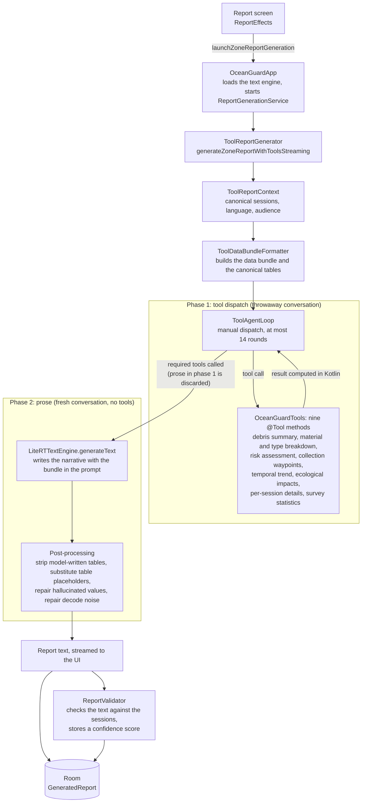
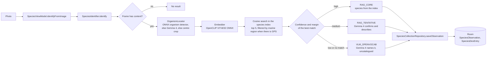
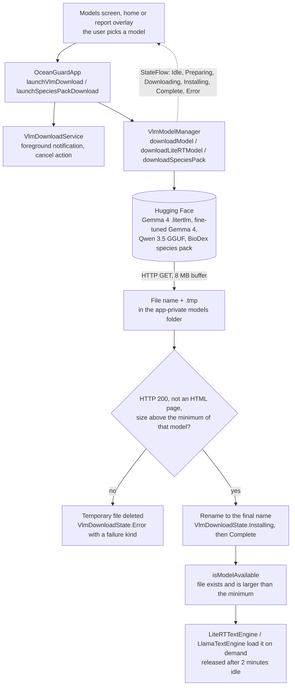

# OceanGuard AI - flow diagrams

How the main paths of the app work. Every box is a class or file under
`android/app/src/main/java/com/oceanguard/`; the names are the ones in the source. For the rest of the technical
description (interfaces, GPU strategy, memory), see [ARCHITECTURE.md](ARCHITECTURE.md).

## Zone report: two phases with typed tools

The report is written by Gemma 4 E2B through LiteRT-LM, in two conversations, so that no number comes from the model.

- **Phase 1.** `ToolAgentLoop` runs with `automaticToolCalling = false`, so the app controls streaming, progress and the
  round limit. The model must call the required tools (seven for a generic report; the temporal trend is added for a
  zone report, and the collection-waypoints tool is not required). If it tries to finish early, the loop discards the
  draft and sends a corrective message, up to three times. If it starts writing prose before the tools are done, the
  turn is cut at 64 characters and the handoff to phase 2 follows. Tool names are compared in a canonical form
  (`ToolNames`), because the SDK, the Kotlin methods and the required sets spell them differently.
- **Phase 2.** A new conversation without tools receives the data bundle and writes the report. The tables are never
  taken from the model: they are removed from its text and replaced with the canonical ones.
- **Validation.** `ReportValidator` runs after the report is saved and stores the score next to it.

The tool-calling path is used when the text engine is LiteRT-LM (Gemma 4). With the llama.cpp engines the app uses
`ReportGenerator`, which has no tools.

## Photo analysis

```mermaid
flowchart LR
    IN["Photo: camera, gallery or batch"] --> VM["MainViewModel.analyzeImage"]
    VM --> SVC["InferenceService<br/>foreground service, job queue"]
    SVC --> ORC["DetectionOrchestrator.analyzeImage"]
    ORC --> PRE["ImagePreprocessor<br/>640x640"]
    PRE --> DET["RT-DETRv2 TFLite FP16<br/>8 classes, threshold from settings"]
    DET --> REF{"Refine with Gemma 4<br/>enabled and ready?"}
    REF -- yes --> G4["Gemma 4 on the same image<br/>DetectionRefiner copies sub-type and material<br/>onto the RT-DETRv2 boxes"]
    REF -- no --> RES
    G4 --> RES["AnalysisResult<br/>canonical debris types, health score"]
    RES --> SAVE["DetectionRepository.saveSession<br/>image copy, annotated thumbnail, EXIF or device location"]
    SAVE --> DB[("Room<br/>DetectionSession")]
    SAVE --> ACH["AchievementChecker<br/>MarineDex entries and achievements"]
```

Marine organisms are identified by a separate path (BioDex), not by this chain:

## Model download and management

RT-DETRv2 ships as an asset of the APK (`models/rtdetrv2_detector.tflite`, see the README). The rest is downloaded on
the device by `VlmModelManager`:

The download state is a `StateFlow` that the UI collects for the progress bar (updates are throttled to about 5 per
second). A failed or cancelled download leaves no partial file, and the app checks the size of every file against a
per-model minimum, which also catches an HTML error page saved as a model. The download starts from the beginning each
time; it is not resumed.

### Getting the report model

A new install starts in Fast mode (RT-DETRv2 for detection, Gemma 4 E2B for reports), so the only missing piece is the
Gemma 4 file that writes reports. Every entry point asks for it through `ModelDownloader`, which checks free space and
the network first and warns on mobile data before it calls `launchVlmDownload`:

- **Home status line.** While the report model is missing, the "Reports" row shows its size and a Download button. It
  is a quiet row, not a pop-up, so there is nothing to dismiss and it never repeats.
- **Report screen.** Pressing Generate without the model opens the download dialog. If the download starts, the report
  starts on its own when it finishes. If it fails, the snackbar offers Retry, which keeps the pending report. Cancelling
  the dialog leaves the screen as it was.
